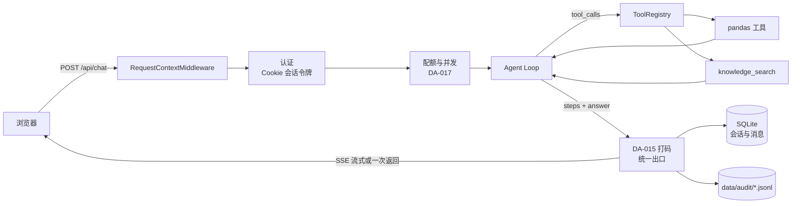
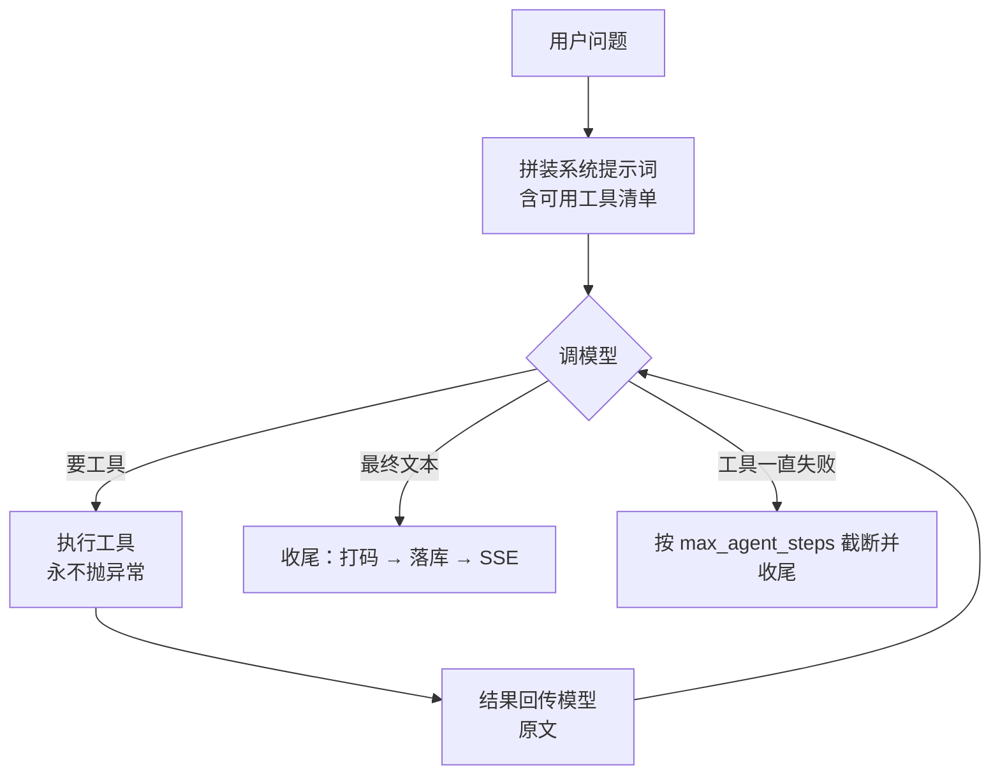
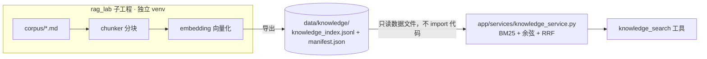

# DataAnalyst Agent

[](LICENSE)
[](https://www.python.org/)
[](#测试)
[](#测试)

> 上传 Excel，由**单 Agent Loop** 自主调用工具（pandas 分析 + 项目文档检索）完成数据分析，
> 只给结论、同时保留可追溯的「分析过程」。

把一份业务 Excel 拖进页面 → 提问 → Agent 先看清数据结构，再真实地用 pandas 算，最后给结论。
它不是"把表丢给模型硬猜"：所有数字都来自工具执行，界面里能逐步展开每一步**调了什么工具、入参是什么、返回了什么**。

> ⚠️ **安全提示**：`run_pandas` 的 AST 沙箱**不是安全边界**，已确认存在绕过方式
> （`pd.eval` 字符串表达式、`pd.ExcelFile` 等）。请只部署在信任提问者的场景，
> 或放进容器里跑。详见 [SECURITY.md](SECURITY.md)。

---

## 能力一览

| 能力 | 说明 |
| --- | --- |
| 结论先行 | 回答只给结论与口径，不往结论里粘贴代码（过程在「执行过程」面板里） |
| 真实计算 | 全部统计由 pandas 在**受限沙箱**里执行，禁止文件读写与 `import` |
| 过程可追溯 | 每一步工具调用的参数与结果都在界面可展开；同时落**审计 JSONL** |
| 单表分析 | 明确只做单表（切换工作表会整体替换 `df`），不支持跨表 join |
| 数据体检 | 一次调用拿到整表「结构 + 缺失 + 异常值 + 告警」，不逐列串行探查 |
| 数据库文档检索 | `knowledge_search` 可检索**项目自身文档**（口径/架构/限制），带来源（文档+章节+行号） |
| 连续追问 | 会话持久化到 SQLite，刷新/换机器/重启都不丢 |
| 报告导出 | 一键导出 Markdown / Excel（结论 + 数据明细 + 执行轨迹） |
| 多用户隔离 | 归属校验（越权返回 404，不泄露"存在性"）、登录态、管理员可建用户 |
| 敏感字段打码 | 手机号/身份证/银行卡/邮箱按规则遮蔽；**只对外脱敏，喂给模型的仍是原文** |
| 配额与并发 | 按用户/会话限流 + 全局并发上限，超限返回 429 与 `Retry-After` |

---

## 快速开始

前置：Python **≥ 3.12** 与 [uv](https://docs.astral.sh/uv/)（开发时用的是 3.14，3.12/3.13 同样可跑）。

```bash
# 1) 安装依赖（会创建 .venv）
uv sync

# 2) 配置：复制模板后填入你的模型 Key
#    Windows: copy .env.example .env
cp .env.example .env
#    至少填写：AGENT_LLM_API_KEY（其余有合理默认值）
#    首次启动还需要：AGENT_AUTH_ADMIN_USERNAME / AGENT_AUTH_ADMIN_PASSWORD

# 3) 启动
uv run uvicorn main:app --reload
```

打开 <http://127.0.0.1:8000>，用第 2 步配置的管理员账号登录，上传 Excel 即可。

**离线跑通（不联网、不花额度）**：把 `.env` 改成 `AGENT_LLM_PROVIDER=mock` 再启动，
模型会走本地假剧本，用于验证链路与界面。

**启用知识库检索（可选）**：

```bash
# 在子工程里把语料构建成主工程可读的工件（导出前需装好 rag_lab 自己的依赖）
cd rag_lab
uv sync
cp .env.example .env      # 填向量服务（RAG_LAB_EMBEDDING_*）
uv run python -m rag_lab.chunker         # 语料分块
uv run python -m rag_lab.embedding       # 生成向量（追加写、可断点续跑）
uv run python -m rag_lab.export_index    # 导出 data/knowledge/
cd ..
```

> `data/*` 不入库（见 `.gitignore`），所以**新克隆的仓库没有知识库工件**，此时
> `knowledge_search` 会如实回一句「知识库未构建」并给出上面这条导出命令 —— 这是有意设计：
> 工件可再生，不该入库。不导出也不影响其它功能（工具照常注册，只是报"未构建"）。

---

## 架构

### 1) 一次提问的完整链路



要点：**打码只发生在最后一个出口**，喂给模型的工具输出始终是原文（否则 `groupby('手机号')` 会算错）。

### 2) Agent Loop



- 循环上限 `AGENT_MAX_AGENT_STEPS`（默认 12），到顶会让模型基于已有结果收尾，而不是直接丢弃；
- 工具异常**不中断**循环：错误回传给模型自纠（对用户只显示人话，traceback 只进日志）；
- 超过 8 次工具调用且答案里找不到提问关键词 → 记一条「疑似任务漂移」告警日志。

### 3) 工具注册与执行

```mermaid
flowchart LR
    A[app/tools/__init__.py] -->|导入即注册| R[ToolRegistry 单例]
    B[pandas_tools.py<br/>@tool 装饰器] --> R
    C[knowledge_tools.py<br/>register_knowledge_tool] --> R
    R --> S[openai_schemas<br/>给模型的 function-calling schema]
    R --> X[run：校验参数 → 执行 → 格式化]
    X --> AU[审计 record_tool_call<br/>只记形状不记内容]
```

`knowledge_search` 走**显式注册**而不是装饰器：`AGENT_KNOWLEDGE_ENABLED=false` 时它必须
"连 schema 都不出现"，装饰器做不到这一点。

### 4) 知识库：构建期与运行期分开



两个子工程的虚拟环境与依赖完全分开，**主工程可独立部署**；接口是数据格式而不是代码耦合。

---

## 目录结构

```
app/
  main.py                 FastAPI 应用与 lifespan（启动即校验配置）
  config.py               全部配置项（AGENT_* 环境变量）与校验规则
  agent/                  Agent Loop、系统提示词、SSE 事件
  tools/                  工具注册表 + 11 个工具（含 knowledge_search）
  services/               配额、导出、认证、知识库检索
  security/               口令哈希、敏感字段打码
  storage/                SQLite 会话/配额/认证仓库、上传文件、导出产物
  llm/                    OpenAI 兼容客户端 + 离线 mock 客户端
  routers/                files / chat / chat+stream / sessions / export / auth
  web/                    前端静态页（index.html + app.js/auth.js/history.js/style.css）
tests/                    542 条用例，全程离线（MockLLM + tmp_path）
docs/                     PRD、工单（DA-015/017/018）、交付验证报告、性能记录
data/samples/             5 套业务测试数据集 + 测试指南 + 生成/校验脚本
rag_lab/                  RAG 子工程（分块/向量/检索/评估，独立 venv）
```

---

## 工具清单（11 个）

| 工具 | 什么时候用 |
| --- | --- |
| `list_sheets` | 分析前先看清有哪些工作表 |
| `load_sheet` | 把某张表设为「当前工作表」；切换分析目标的唯一入口 |
| `data_health_check` | **优先使用**：一次拿到整表结构 + 缺失 + 异常值 + 告警 |
| `preview_rows` | 看前 N 行原始数据、确认脏值长什么样 |
| `column_profile` | 逐列画像（类型/缺失/唯一值/极值） |
| `value_counts` | 类别列的取值分布 Top N |
| `describe_dataframe` | 数值列描述统计 |
| `correlation` | 数值列相关系数矩阵 |
| `find_value` | **提问里出现具体人名/商品名/门店名/订单号时先用它**确认存在性 |
| `run_pandas` | 兜底万能工具：自定义统计、分组、透视、时间趋势（沙箱执行） |
| `knowledge_search` | 问**本项目自身**的口径/规则/架构/限制时用；只查项目文档，不查用户的表 |

---

## HTTP 接口

| 方法 | 路径 | 说明 |
| --- | --- | --- |
| GET | `/` | 前端页面 |
| GET | `/api/health` | 健康检查（含 provider / model / max_steps） |
| POST | `/api/files/upload` | 上传 Excel（multipart `file`），返回 `session_id` 与工作表列表 |
| GET | `/api/files/{session_id}` | 会话文件信息 |
| DELETE | `/api/files/{session_id}` | 删除会话（含文件与消息） |
| POST | `/api/chat` | 提问（JSON：`session_id` + `message`），返回答案与 `steps` |
| POST | `/api/chat/stream` | 同上但走 SSE（`start` / `tool_args` / `step` / `token` / `done`） |
| POST | `/api/chat/reset` | 清空当前会话上下文 |
| GET | `/api/sessions` | 历史会话列表（**按登录用户隔离**） |
| GET | `/api/sessions/{session_id}` | 会话详情（消息 + 步骤） |
| GET | `/api/sessions/{session_id}/export` | 导出 Markdown / Excel |
| GET/POST | `/api/auth/me` `/login` `/logout` `/password` `/users` | 登录态与用户管理 |
| GET | `/docs` | OpenAPI 文档 |

---

## 配置速查

全部配置走环境变量（前缀 `AGENT_`）或项目根目录 `.env`；**每一项都有默认值**，
所以一份旧 `.env` 升级后仍能启动（不会被新增键拦住）。

### 模型（`AGENT_LLM_*`）

| 变量 | 默认 | 说明 |
| --- | --- | --- |
| `AGENT_LLM_PROVIDER` | `openai` | `openai`=任意 OpenAI 兼容接口；`mock`=本地假模型（离线） |
| `AGENT_LLM_API_KEY` | 空 | `openai` 模式必填 |
| `AGENT_LLM_BASE_URL` | `https://api.openai.com/v1` | 换厂商只改这一行 |
| `AGENT_LLM_MODEL` | `gpt-4o-mini` | 例如 `deepseek-chat` |
| `AGENT_LLM_TIMEOUT` / `AGENT_LLM_MAX_RETRIES` | `120` / `2` | 超时与重试 |

### Agent 行为

| 变量 | 默认 | 说明 |
| --- | --- | --- |
| `AGENT_MAX_AGENT_STEPS` | `12` | 单次提问的「模型思考 + 工具调用」上限 |
| `AGENT_MAX_TOOL_OUTPUT_CHARS` | `4000` | 单次工具输出给模型的字符上限（超长会截断） |
| `AGENT_MAX_SANDBOX_CODE_LINES` | `80` | `run_pandas` 允许的最大代码行数 |
| `AGENT_STRICT_CONFIG` | `true` | 配置不合法是否拒绝启动（fail-fast） |

### 上传 / 会话 / 审计

| 变量 | 默认 | 说明 |
| --- | --- | --- |
| `AGENT_MAX_UPLOAD_BYTES` | `52428800` | 单文件上限（50 MB） |
| `AGENT_DB_PATH` | `data/agent.db` | SQLite 会话库 |
| `AGENT_AUDIT_DIR` / `AGENT_AUDIT_ENABLED` | `data/audit` / `true` | 工具调用审计（**只记形状不记内容**） |
| `AGENT_LOG_FORMAT` / `AGENT_LOG_LEVEL` | `text` / `INFO` | `json` 便于日志系统采集 |

### 认证

| 变量 | 默认 | 说明 |
| --- | --- | --- |
| `AGENT_AUTH_ENABLED` | `true` | 生产务必开启 |
| `AGENT_AUTH_ADMIN_USERNAME` / `_PASSWORD` | 空 | 首次启动创建的管理员；口令至少 8 位 |
| `AGENT_SESSION_TTL_HOURS` | `12` | 登录态有效期 |
| `AGENT_AUTH_COOKIE_SECURE` | `false` | 走 HTTPS 时置 `true` |
| `AGENT_AUTH_PASSWORD_ITERATIONS` | `600000` | PBKDF2 迭代数（生产用 OWASP 推荐值） |

### 配额与并发（DA-017）

`quota_enabled=true`，`quota_user_per_minute=10`、`quota_user_per_day=50`、
`quota_session_per_minute=5`、`quota_max_concurrency_per_user=1`、
`quota_max_concurrency_global=4`、`quota_retry_after_seconds=5`、`quota_timezone=Asia/Shanghai`。
超限返回 429 + `Retry-After`。

### 敏感字段打码（DA-015）

`redact_enabled=true`；`redact_columns` 是**追加**到内置列名关键词（手机/电话/身份证/邮箱/地址/薪资…），
留空表示只用内置集。**只对外（界面/导出/落盘）打码，喂给模型的仍是原文**。

### 知识库检索（DA-018）

| 变量 | 默认 | 说明 |
| --- | --- | --- |
| `AGENT_KNOWLEDGE_ENABLED` | `true` | `false` 时工具**不注册**，提示词也不提它 |
| `AGENT_KNOWLEDGE_TOP_K` / `_MAX` | `5` / `10` | 默认返回条数与上限（上限进 schema） |
| `AGENT_KNOWLEDGE_MAX_CHARS` | `2400` | 工具输出的整体预算（**硬上限**） |
| `AGENT_KNOWLEDGE_SNIPPET_CHARS` | `300` | 单条片段正文字数 |
| `AGENT_KNOWLEDGE_MIN_VECTOR_SCORE` / `_KEYWORD_SCORE` | `0.35` / `1.0` | 两路最低分，低于它的片段不进榜 |

### 查询向量化（可选）

`AGENT_EMBEDDING_BASE_URL` / `_API_KEY` / `_MODEL` **三项要么都填**（混合检索：向量+关键词），
**要么都留空**（纯关键词模式，完全不需要向量服务）；只填一部分会被启动校验挡住。
另有 `AGENT_EMBEDDING_TIMEOUT=15`、`AGENT_EMBEDDING_TRUST_ENV=true`。

---

## 测试

```bash
# 主工程：542 条，全程离线（MockLLM + tmp_path），覆盖率线 70%（实测 92%）
uv run pytest -q

# 只跑某个模块
uv run pytest tests/test_registry.py -q

# 子工程（RAG）：独立 venv，123 条
cd rag_lab && uv run pytest -q
```

业务数据集可随时重算真值（用项目自身 pandas 链，与 Agent 走同一套逻辑）：

```bash
uv run python data/samples/verify_datasets.py   # 35 项断言
```

---

## 部署约束与已知限制

请如实了解以下边界，它们都是**有意选择**而非疏漏：

1. **只支持单进程**：配额与并发的分钟窗口是进程内状态，不跨 worker 共享（多 worker 部署会失去限流一致性）。
2. **`data/*` 不入库**：知识库工件、上传文件、SQLite、审计都属于运行期产物；
   新克隆的仓库需要跑一次导出才有知识库（工具会明确提示）。
3. **不配向量服务时按关键词模式**：效果略低于混合检索（评估 recall@5 0.944 vs 1.000），
   工具返回里会写明当前模式。
4. **SSE 逐字流式期间打码有短暂窗口**：token 边界无法打码，落定时会用脱敏版整体替换
   （详见 `docs/DA-015-敏感字段打码.md` 的已知限制）。
5. **单表分析**：不支持跨表 join；需要多表就分别 `run_pandas(sheet=...)` 分析并按口径自行组合。
6. **`run_pandas` 沙箱不是安全边界（重要）**：它基于 AST 黑名单过滤，只能挡住
   "直白写法"（`import` / `open` / `to_csv` / `read_*` / dunder）。已确认可绕过：
   `pd.eval` / `df.eval` / `df.query` 的**字符串表达式**看不到内部内容，配合
   `pd.io.common.os` 可拿到 `os` 模块进而执行系统命令；`pd.ExcelFile` / `pd.ExcelWriter`
   未列入黑名单，可读写任意路径文件；`df.apply('to_csv', ...)` 用字符串派发绕过属性名检查。
   **因此：不要把它当成多租户隔离手段。** 只应部署在你能信任「提问者」的场景（本机 / 内网），
   或在容器/虚拟机里运行并限制其对宿主文件的访问。彻底修复需要改成
   「子进程 + seccomp/容器 + 资源限额」，属于后续工作。
7. **无 CI / 容器化**：本仓库目前未附带这两项（LICENSE 已补 MIT）。

---

## 文档索引

| 文档 | 内容 |
| --- | --- |
| [`docs/PRD-产品需求文档.md`](docs/PRD-产品需求文档.md) | 产品需求、迭代路线与验收门 |
| [`docs/DA-015-敏感字段打码.md`](docs/DA-015-敏感字段打码.md) | 打码规则与双通路设计 |
| [`docs/DA-017-配额与并发保护.md`](docs/DA-017-配额与并发保护.md) | 限流维度、并发模型与单进程假设 |
| [`docs/DA-018-RAG知识库检索接入.md`](docs/DA-018-RAG知识库检索接入.md) | 知识库工具接入与降级策略 |
| [`docs/交付验证报告.md`](docs/交付验证报告.md) | 最终交付检查的实测命令与结果 |
| [`docs/性能优化记录.md`](docs/性能优化记录.md) | 已做的优化与量化证据 |
| [`docs/演示录制脚本与截图清单.md`](docs/演示录制脚本与截图清单.md) | 录屏分镜与截图清单 |
| [`data/samples/测试指南.md`](data/samples/测试指南.md) | 5 套业务数据集的结构、真值与埋入异常 |
| [`rag_lab/README.md`](rag_lab/README.md) | RAG 子工程的实验记录与评估结果 |

## 界面截图

> 截图待补充：把图片放到 `docs/images/`（例如 `docs/images/01-index.png`），
> 然后在此处替换为 ``。
> 拍摄清单见 [`docs/演示录制脚本与截图清单.md`](docs/演示录制脚本与截图清单.md)。

---

## 安全

请先读 [`SECURITY.md`](SECURITY.md)。最重要的一条：**`run_pandas` 沙箱不是安全边界**，
不要用它做多租户隔离。

## 贡献

欢迎 issue 与 PR。提交前请确保：

```bash
uv run pytest -q        # 542 条全绿，覆盖率不低于 70%
```

代码风格遵循仓库既有约定（中文注释解释「为什么」而非「做了什么」、
每个设计取舍在注释里写清权衡）。

## 许可证

[MIT](LICENSE) © 2026 DataAnalyst Agent contributors

