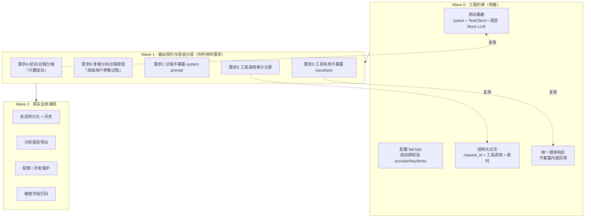

# DataAnalyst Agent · 产品需求文档（PRD）

> 角色：产品经理视角 → 交付工程团队
> 版本：v0.2 草案（供评审，尚未实施）
> 日期：2026-06-14
> 项目：电商公司内部数据分析助手（上传 Excel → Agent 自主调 pandas 分析）

---

## 0. 文档目的

这份文档回答一个问题：**这个目前的内部原型，要经过哪些"真实约束"，才能变成一个敢让全公司几百号人用的内部工具？**

方法上刻意还原真实产品迭代——先立工程约束，再按业务反馈逐条叠需求，每一步都写清**为什么需要**、**验收标准**、**预估改动量与复杂度增量**。请评审后决定哪些 Wave、哪些条目进入实施。

---

## 1. 项目现状（实测基线，非估计）

| 维度 | 当前值 | 证据 |
| --- | --- | --- |
| 后端 Python | **1783 行**（`pandas_tools.py` 524 / `loop.py` 183 / `session_store.py` 164 / `base.py` 135 / `openai_client.py` 100 / `registry.py` 76 …） | `wc -l` |
| 前端 | **480 行**（`app.js` 249 / `style.css` 155 / `index.html` 76） | `wc -l` |
| 测试 | **0**（无 tests 目录、无 pytest、无 CI） | `find`/`import pytest` 实测 |
| 已注册工具 | 9 个（含新增的 `data_health_check` 聚合体检工具） | `app/tools/pandas_tools.py` |
| 最近提交 | `c4af538 feat(tools): data_health_check`、`3249284 v0.1 单 Agent Loop 跑通` | `git log` |
| 配置 | `.env` 存在（provider 默认 `openai`，另有 `mock` 模式可离线跑） | `.env.example` |
| 输出契约 | `ChatResponse{answer, steps[], stop_reason, usage}` | `app/schemas.py:44-48` |

### 1.1 现存的结构性缺口（本轮需求要解决的根）

这些不是"缺陷"（原型阶段可以没有），而是**上线前必须补的工程约束**。每条都附实测证据：

| # | 缺口 | 现状证据（file:line） | 上线风险 |
| --- | --- | --- | --- |
| G1 | **无自动化测试** | `tests` 目录不存在，`import pytest` 失败 | 任何改动都是"裸奔"，改一处不知会不会崩别处 |
| G2 | **结论与过程未分层** | `answer` 与 `steps` 并列回传（`schemas.py:45-46`）；`run_pandas` 的 `code` 参数原样进 `ToolStep.arguments`（`loop.py:129`）→ 前端展示 = **暴露 Python 代码** | 普通用户看到一大坨代码，体验差、也泄露实现 |
| G3 | **内部异常直接透给用户** | `loop.py:103` `answer=f"模型调用失败：{exc}"`；`loop.py:160` `answer=f"…收尾请求失败：{exc}"` | 用户看到 `httpx.ConnectError`、URL、可能的 key 片段 |
| G4 | **工具失败暴露内部类型** | `registry.py:71` `return False, f"[RuntimeError] {type(exc).__name__}: {exc}"`；`pandas_tools.py:497` `raise ToolError(f"{type(exc).__name__}: {exc}")` | traceback 信息（异常类名 + 原始消息）回传前端 |
| G5 | **无审计记录** | `Session.messages` 仅内存态、不落盘（`session_store.py:38`）；`meta.json` 只存文件元信息 | 出问题无法回溯"哪次调了什么工具、参数是什么" |
| G6 | **系统 prompt 无隔离边界** | `build_system_prompt` 产物只进 `working`（`loop.py:89`），目前**未**回传给前端——但**无机制保证**未来不会（缺少显式的不变量测试） | 一旦有人改错，system prompt 会随 `steps`/`answer` 泄出 |
| G7 | **无请求级日志/追踪** | `main.py` 无任何中间件（实测无 `add_middleware`/`exception_handler`）；现有 `uuid` 仅用于 session_id 与 mock 的 call_id | 线上排障只能靠猜 |
| G8 | **配置不在启动时校验** | `get_settings()` 只 `mkdir`（`config.py`）；key 缺失要等到用户提问才在 `openai_client.py:28` 抛错 | 坏配置上线后才发现 |

**要点**：G6 当前**不是泄漏**（system 确实没回传），但它是"靠代码没写错"维持的，而非"靠机制保证的"——大厂做法是把它变成一条受测试保护的不变量（见 Wave1-需求 C）。

---

## 2. 迭代路线总览

**依赖说明**：Wave 1 的 5 条需求都要改 `loop.py` 的输出组装与 `app.js` 的渲染——**没有 Wave 0 的测试网，这些改动全靠人工回归，风险高**。所以推荐的实施顺序是 W0 → W1 → W2，但**每一 Wave 可独立交付、独立验收**。

---

## 3. Wave 0 · 工程约束（先立地基）

> 目标：让项目"可被安全修改"。这一步不产生用户可见功能，但决定后续所有需求的实施成本。

### 需求 W0-1：测试基建

- **为什么**：当前 0 测试（G1）。你列举的 5 条需求全部要动 `loop.py` 的输出契约。没有特征测试（characterization test）锁住现有行为，重构等于蒙眼改。
- **做什么**
  1. 引入 `pytest` + `pytest-asyncio`（dev 依赖）
  2. 用 `MockLLMClient` 作为固定 LLM，写第一批**特征测试**：覆盖 `/api/health`、上传、`/api/chat`（无文件 / 有文件 / 工具失败 / 达到步数上限）、`/api/chat/reset`
  3. 直接测试 `registry.run` 的错误契约（"永不抛异常，返回 (ok, text)"）
- **验收标准**
  - `pytest -q` 全绿；**覆盖率 ≥ 70%**（含 `loop.py` / `registry.py` / `session_store.py`）
  - 至少 1 个测试锁定"`ChatResponse` 字段集合"这一契约（防止后续悄悄改契约）
  - 测试不依赖网络（用 Mock LLM），CI 可离线跑
- **预估复杂度**：🟡 中。新增约 300–400 行测试代码。**风险点**：`TestClient` 与 async Agent Loop 的配合、mock 的可控性。
- **预估工作量**：1–1.5 天

### 需求 W0-2：配置启动即校验（fail-fast）

- **为什么**：G8。坏配置要等到用户第一次提问才暴露（`openai_client.py:28`），上线后才发现很尴尬。
- **做什么**：在 `lifespan`（`main.py`）里做一次配置自检——provider 合法性、openai 模式下 key 是否为空、limits 是否为正；失败则**启动即失败并打印清晰指引**。
- **验收标准**
  - `provider=openai` 且无 key 时，服务**启动即退出**并给出可操作提示；`provider=mock` 时正常启动
  - 有对应测试覆盖两种分支
- **预估复杂度**：🟢 低，~30 行 + 测试
- **工作量**：0.5 天

### 需求 W0-3：结构化日志与请求追踪

- **为什么**：G7。线上排障没有 request_id 就无法把一次用户报错和后端日志对上。
- **做什么**：为每个 `/api/chat` 请求生成 `request_id`；在关键节点（收到请求 / 每次工具调用 / 每次 LLM 调用 / 结束）打结构化日志（含耗时、工具名、成败、步数）。`request_id` 通过响应头回传，便于用户报错时提供。
- **验收标准**
  - 一次提问的日志能用 `request_id` 串起全部工具调用与最终结果
  - 日志**不含** API key、system prompt 全文
  - 测试断言：成功请求会产生 ≥1 条带 `request_id` 的日志
- **预估复杂度**：🟡 中，需引入轻量中间件或按请求注入 context
- **工作量**：1 天（这一条是 Wave1 需求 E 的底座）

### 需求 W0-4：统一错误响应，不暴露内部异常

- **为什么**：G3/G4。当前 `loop.py:103/160` 和 `registry.py:71` 会把异常类名、原始消息直接给用户。
- **做什么**：建立错误分类（用户错误 / 上游 LLM 错误 / 内部错误），对外统一为**安全、友好、带 request_id** 的文案；详细堆栈只进日志。
- **验收标准**
  - 构造一次 LLM 连接失败，`ChatResponse.answer` **不含**异常类名、URL、堆栈
  - 构造一次工具内部异常，前端 `steps` 里**不含** `RuntimeError`/traceback 字样
  - 有测试对这两条做**反向断言**（"不含 X"）
- **预估复杂度**：🟡 中
- **工作量**：1 天（Wave1 需求 D 的底座）

**Wave 0 合计预估**：约 3.5 天，新增 ~500–700 行（测试为主）。这解释了"为什么地基比功能还贵"。

---

## 4. Wave 1 · 你列举的 5 条需求

> 这一 Wave 是本次任务的核心，逐条对应你给的场景。

### 需求 A：分析结果只要结论，不展示 Python 代码

- **业务原话**：_"用户说分析结果太长了，只要给结论，不要把 Python 代码展示出来。"_
- **现状证据**：`steps` 里 `run_pandas` 的 `code` 参数会原样进 `ToolStep.arguments`（`loop.py:126-129`），前端 `renderSteps` 把它渲染进页面（`app.js:107-119`）。用户看到的就是 Python 代码。
- **做什么**：后端在**响应组装层**就区分 `answer`（结论）与 `trace`（过程），并默认**不回传**任何工具参数中的代码。前端默认只渲染 `answer`。
- **验收标准**
  - 默认响应（不带任何查询参数）中，**前端可见内容不含** `code=` / `df.` / `import` 等代码片段
  - `answer` 内容与工具调用过程**可独立存在**（契约上解耦）
  - 有测试断言"默认响应 renderSteps 不出现在 DOM"或"steps 默认不返回"
- **预估复杂度**：🟡 中（改契约 + 改前端 + 测试）。**风险点**：后端契约变更影响 `ChatResponse.steps` 的所有消费方。
- **工作量**：1 天

### 需求 B："查看分析过程"按钮（高级用户想看过程）

- **业务原话**：_"但是高级用户又希望看到分析过程。"_ → _"那增加一个'查看分析过程'按钮。"_
- **现状证据**：当前过程是**默认展开**的 `
`（`app.js:107`），没有开关；对话区头部只有"清空对话"按钮（`index.html:55`）。
- **做什么**：默认收起过程；提供显式"查看分析过程"入口（按消息 or 全局开关，见待决策项）。点击后按需展示工具调用序列。
- **验收标准**
  - 用户不点击时，过程**不可见**；点击后可见完整工具序列（工具名、参数、结果/错误）
  - 开关状态在单条消息级别可控（不需要刷新页面）
  - 交互有测试或可复现的手动验收脚本
- **预估复杂度**：🟡 中（前端为主 + 契约取过程数据的接口）
- **工作量**：0.5–1 天

### 需求 C：分析过程里不能暴露系统 prompt

- **业务原话**：_"分析过程里面不能暴露系统 prompt。"_
- **现状证据**：**当前 system prompt 并未回传**（`loop.py:89` 只进 `working`，不进 `steps`）——即现状是安全的。但**没有任何机制/测试保证**这一点（G6）。
- **做什么**：把"system prompt 绝不进入任何对外响应"变成一条**受测试保护的不变量**。后端显式定义"可外发字段白名单"（工具名、脱敏参数、结果摘要），`trace` 组装时只从白名单取字段。
- **验收标准**
  - 存在一条测试：发送任意问题后，`ChatResponse` 全字段序列化后**不含** system prompt 的特征串（例如 `_WORKFLOW` 里的固定句子）
  - 该测试在需求 A/B 改动后**仍然通过**（防止回归）
- **预估复杂度**：🟢 低（主要是测试 + 白名单校验），但**价值高**——它把"碰巧安全"变成"证明安全"
- **工作量**：0.5 天

### 需求 D：工具调用失败时用户不能看到 traceback

- **业务原话**：_"如果 Agent 调用工具失败，用户不能看到 traceback。"_
- **现状证据**：G4。`registry.py:71` 返回 `[RuntimeError] 类名: 消息`；`pandas_tools.py:497` 亦带 `type(exc).__name__`。这些会进 `ToolStep.error`（`loop.py:131`）再被前端渲染（`app.js:119`）。
- **做什么**：工具失败的**对外**呈现统一为一句话人话（"该分析步骤执行失败，已跳过"）；详细原因只进日志（配合 W0-3）。注意：**对模型**仍可返回原始错误（Agent 需要靠错误自我纠正），但**对用户**要脱敏——这要求"给模型的 tool 消息"与"给用户的 trace"是两条通路。
- **验收标准**
  - 制造一次工具内部异常，用户可见的 `steps[i].error` **不含**堆栈、类名、文件路径
  - 同时，Agent Loop **仍能**基于错误自我纠正（用 Mock 验证：第一次工具失败 → 第二次成功）
  - 两条通路都有测试
- **预估复杂度**：🔴 中高。**这是本 Wave 最复杂的一条**——需要把"模型可见"与"用户可见"彻底分开，触及 `loop.py` 的双份记录。
- **工作量**：1.5 天

### 需求 E：记录每次 Agent 调用了什么工具（便于排查）

- **业务原话**：_"需要记录每次 Agent 调用了什么工具，方便排查问题。"_
- **现状证据**：G5。`ToolStep` 只在单次响应内存在，**不落盘**；`Session.messages` 是内存态（`session_store.py:38`），进程重启即丢。
- **做什么**：把每次工具调用落成审计记录（session_id / request_id / 时间 / 工具名 / 参数摘要 / 耗时 / 成败 / 错误摘要），可写入 `data/audit/`（JSONL）或会话目录。提供查询接口（至少按 session_id）。
- **验收标准**
  - 一次提问后，审计文件出现与 `steps` **条数一致**的记录
  - 记录**不含** system prompt、不含 API key、参数中的敏感值已摘要化
  - 有测试校验条数与字段完整性
- **预估复杂度**：🟡 中（存储 + 埋点 + 接口）
- **工作量**：1–1.5 天（依赖 W0-3 的日志基建）

**Wave 1 合计预估**：约 5 天，新增 ~600–900 行（后端契约重构 + 前端 + 审计）。

---

## 5. Wave 2 · 真实业务涌现后（预告，本次不实施）

> 这些是"用户开始真的用了"之后自然长出来的需求，列出让路线完整，**本轮不要求评审细节**。

| 需求 | 触发场景 | 验收要点 | 复杂度 |
| --- | --- | --- | --- |
| W2-1 会话持久化 | 用户刷新页面 / 换机器，历史对话丢失 | 对话历史落盘，重启可恢复；提供历史会话列表 | 🟡 |
| W2-2 分析报告导出 | 用户要把结论发给同事 | 一键导出 Markdown/Excel（结论 + 图表数据） | 🟡 |
| W2-3 配额与并发保护 | 多人同时用，担心 LLM 费用失控 | 按用户/会话限流；并发上限；超限友好提示 | 🔴 |
| W2-4 敏感字段打码 | 数据含手机号/身份证，怕展示给无权限的人 | 展示层按配置对指定列打码（`138****8888`） | 🟡 |

---

## 6. 复杂度与代码量预估

你的预期是"500 行 → 3000~5000 行"。基于实测基线（2263 行）与上述逐条预估：

| 阶段 | 新增行数（估） | 累计行数（估） |
| --- | --- | --- |
| 现状 | — | **2263** |
| + Wave 0 | ~500–700（多为测试） | ~2800–3000 |
| + Wave 1 | ~600–900 | ~3400–3900 |
| + Wave 2 | ~800–1200 | ~4200–5100 |

**关键结论（也是你想验证的）**：增长到 4000+ 行是**必然**的，但来源可拆解——**测试约占 35%，分层/脱敏/审计约占 40%，真正的新功能不到 25%**。每一条新增都对着一个具体约束，没有一行是"为了复杂而复杂"。

---

## 7. 待你决策的开放项

1. **实施范围**：全做（W0→W1→W2）？还是先只做 W0+W1？还是只挑你列举的 5 条（W1，跳过地基）？
2. **"查看分析过程"的粒度（需求 B）**：每条消息各自一个折叠开关（推荐）？还是对话区顶部一个全局开关？
3. **过程展示的默认对象**：默认全员已登录即可看过程？还是区分"普通用户/高级用户"角色（需要先有身份体系）？——影响需求 A/B 是否需要权限判断。
4. **审计落盘位置（需求 E）**：`data/audit/*.jsonl`（简单、够用，推荐）？还是写进每个会话目录（利于按会话清理）？
5. **错误对模型的可见性（需求 D）**：确认"对模型保留原始错误供其自我纠正、对用户脱敏"这一双通路设计是否接受？

---

## 8. 本 Wave 的验收门（若获批实施）

- 每个需求：先写测试（RED）→ 实现（GREEN）→ 全量回归
- 每个 Wave 结束：`pytest -q` 全绿 + 一条端到端实测（上传真实 Excel → 提问 → 核对响应契约）
- 交付报告含三项：做了什么 / 遗留什么 / 与本文档的设计偏差